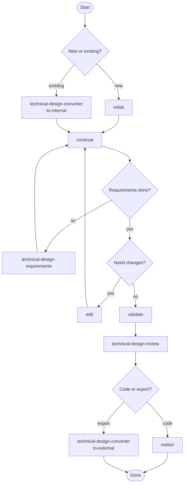

# About

Agent skill for a component-based technical design. It creates a design directory and a root document, then walks requirements, solution cards, review, and validation before implementation.

## Concept

The technical design process implements the human-to-human and human-to-AI concepts.

The process is not intended for fully AI-driven generation and is not a replacement for AI-SDD approaches. 
It enables comfortable human participation in the chain of AI-driven and human decision-making.

## Process map




| Process / skill | When it runs |
| --------------- | ------------ |
| `initial` / `technical-design-converter` (`to-internal`) | Start a new design, or bring in an existing one |
| `continue` | Design requirements and solutions |
| `technical-design-requirements` | Gather and record requirements via dialogue |
| `edit` | Change the design or related components |
| `validate` | Check completeness, diagrams, and wording |
| `technical-design-review` | Check that solutions meet the requirements |
| `realize` / `technical-design-converter` (`to-external`) | Write the code, or export the design |

## Quick Start

```
npm install -g @ilsrk/technical-design@latest

npm skills add ilsrk/technical-design

```
